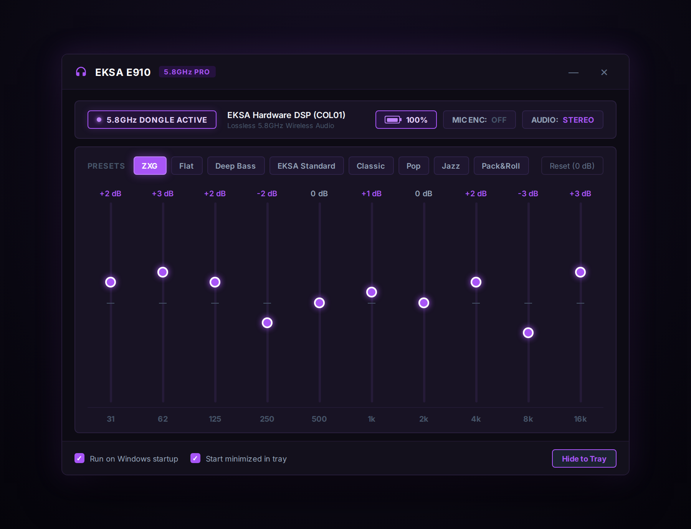

# EKSA E910 5.8GHz Companion (`EksaTray`)

<p align="center">
  
</p>

A lightweight, native Windows WPF system-tray companion for the **EKSA E910 5.8GHz Wireless Gaming Headset** (`VID_3206&PID_0F06`), replacing the legacy OEM `ToneTuningTool.exe` with a modern dark-purple UI, smooth animations, hardware DSP EQ control, and a calibrated battery indicator.

## Features

- **Direct Hardware 10-Band Parametric EQ (`COL01` HID)**:
  - Writes true biquad filter coefficients (`b0, b1, b2, a1, a2` Q2.30 fixed-point) directly to the EKSA 5.8GHz USB transmitter DSP (`SetPEQ` `0x21` + `SetAlgorithmSwitch` `0x31`).
  - Supports 8 presets (**ZXG**, **Flat**, **Deep Bass**, **EKSA Standard**, **Classic**, **Pop**, **Jazz**, **Pack&Roll**) plus **Custom** per-band tuning (`-10 dB` to `+10 dB`).
- **7.1 Virtual Surround & Stereo Toggle**:
  - Instant hardware DSP switching between Stereo and 7.1 Surround (`SetAlgorithmSwitch`).
- **Hardware Mic ENC (Environmental Noise Cancellation)**:
  - One-click hardware microphone noise-cancellation toggle (`SetAlgorithmSwitch`).
- **Calibrated Battery Indicator**:
  - Tracks active usage time (calibrated to reach **20% after 5 hours of use** / `16%` per hour drain, `6h 15m` total runtime).
  - One-click reset to `100%` in the top bar or tray context menu, plus automatic overnight charge detection (`>= 3.5 hours` powered off).
- **Zero-Bloat System Tray Integration**:
  - Starts minimized to the Windows system tray, persists settings in `%APPDATA%\EksaCompanion\settings.json`, and supports Windows startup registration.

## Building (`x86`)

`MyHidApi.dll` is a 32-bit native library, so the project targets `x86` on .NET Framework 4.8:

```powershell
& "C:\Windows\Microsoft.NET\Framework\v4.0.30319\MSBuild.exe" EksaCompanion.csproj /p:Configuration=Release /p:Platform=x86 /v:minimal
```

Output executable: `bin\x86\Release\EksaTray.exe`
